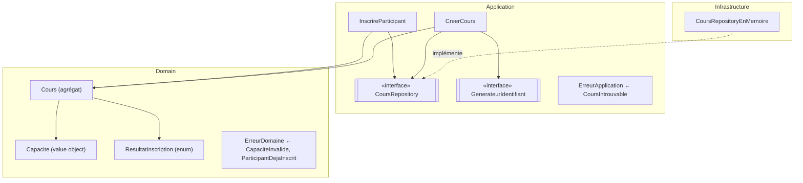

# cleancodesport — réservation de cours de sport

## Équipe

| Composant | Langage | Référent |
|---|---|---|
| auth-service | TypeScript | <Enzo Carbonara> |
| sport-service | PHP 8.3 | <Adlen Soucis> |
| worker | C++ | <Jade Hurpet> |

**Sujet n° 8 — Cours de sport.** Invariant : un cours ne dépasse pas sa capacité ;
au-delà, l'inscription va en liste d'attente. Value object : `Capacite`.

## Architecture de sport-service

Les dépendances vont toujours vers le bas : `Infrastructure → Application → Domain`.
`Domain` n'importe rien ; `Application` n'importe rien d'`Infrastructure`.
La doublure `GenerateurIdentifiantPrevisible` (tests) implémente `GenerateurIdentifiant`.